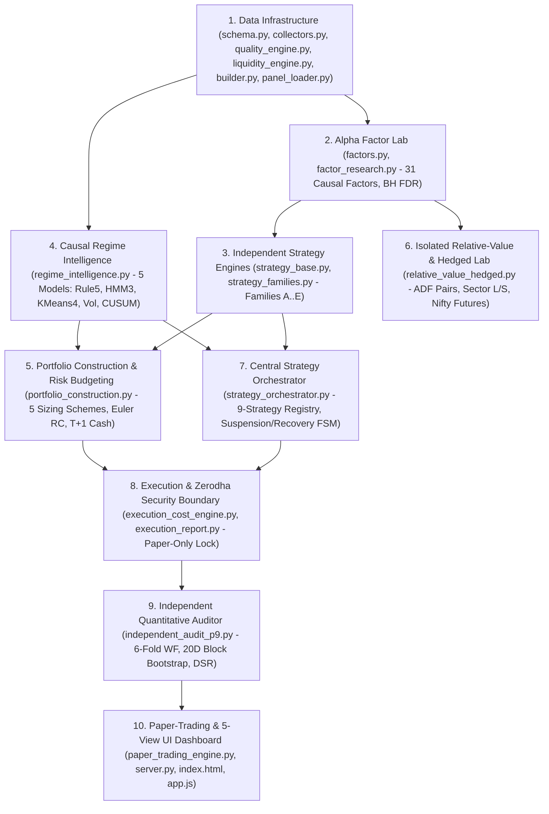

# MORESHWAR 3.0 — SYSTEM ARCHITECTURE, DATA DICTIONARY, API, SECURITY & DEPLOYMENT GUIDE

> [!IMPORTANT]
> **Release Version:** `3.0.0-rc1` (`release/moreshwar-3.0-rc1`)
> **Release Decision:** **`CONDITIONAL GO` (Paper-Trading & Research Monitoring Candidate Only — `NO-GO` for Live Capital Deployment)**
> **Frozen Baseline Protection:** Moreshwar 2.1 (`data/moreshwar_v2_1_experiment_report.json`) and Moreshwar 2.2 (`reports/moreshwar_2_2/integrated_final_report.json`) are preserved 100% untouched.

---

## 1. Modular System Architecture

Moreshwar 3.0 is strictly decomposed into nine non-monolithic Python modules under `finsistant_v2/m3/`:



---

## 2. Data Dictionary (`data/m3_universe/nse_pit_universe.db` & `[T x N]` Panel)

### 2.1 SQLite Database Tables (`finsistant_v2/m3/schema.py`)
| Table | Primary Key | Description & Point-in-Time Rules |
| :--- | :--- | :--- |
| `dataset_versions` | `version_id` | Immutable snapshot ledger (`m3_20261119T191710Z`), SHA-256 checksum, row counts, and source manifest. |
| `trading_calendar` | `trade_date` | `1,454` official NSE trading sessions (`2021-01-01` → `2026-11-19`) with Nifty 50 / Nifty 500 / Midcap 150 OHLC. |
| `security_master` | `sec_id` | `4,416` NSE securities (`ACTIVE`, `DELISTED`, `SUSPENDED`, `HISTORICAL_BHAV`), separating `EQUITY` from `ETF`. |
| `symbol_history` | `(sec_id, symbol, valid_from)` | SCD Type-2 ticker intervals (`1,394` symbol changes, e.g., `CADILAHC -> ZYDUSLIFE`, `MINDTREE -> LTIM`). |
| `daily_bars` | `(trade_date, symbol, series)` | `3,498,739` validated daily bars with unadjusted OHLCV, delivery qty/%, cumulative split/bonus factor, `adj_close`, and official NSE `mcap_inr` (`NULL` pre-2024; never backfilled). |
| `corporate_actions` | `ca_id` | `13,074` parsed Splits, Bonuses, Cash Dividends (`cash_dividend_inr` on `ex_date`), Rights, and Demergers. |
| `daily_liquidity` | `(trade_date, symbol, series)` | Strictly causal (`<= trade_date`) rolling 20D/60D ADV (INR), 60D trading frequency, 20D annualized vol, HL spread proxy, and `is_pit_eligible` (`ADV_20D >= 5 Cr`, `Freq_60D >= 80%`, `Close >= Rs 10`). |
| `data_quality_events` | `event_id` | `2,134` non-silent DQ audit events (`ZERO_VOLUME_BAR`, `STALE_FLAT_BAR`, `UNVERIFIED_EXTREME_MOVE`). |

---

## 3. Strategy Documentation & Registry (`strategy_registry.json`)

| Strategy ID | Family | Rebalance / Horizon | Validated Regimes | Validation Status |
| :--- | :--- | :--- | :--- | :--- |
| `STRAT_A_CS_MOMENTUM` | Cross-Sectional 52W-High & Factor Momentum | 25D Periodic / 90D Max | `STRONG_BULL`, `WEAK_BULL`, `SIDEWAYS_CHOP` | `VALIDATED_CORE_LONG` |
| `STRAT_B_VCP_BREAKOUT` | Volatility-Contraction & Volume/Delivery Breakout | 5D Event Scan / 60D Max | `STRONG_BULL`, `WEAK_BULL` | `VALIDATED_CORE_LONG` |
| `STRAT_C_TREND_PULLBACK` | Primary-Uptrend ATR Pullback Mean-Reversion | 5D Event Scan / 45D Max | `WEAK_BULL`, `SIDEWAYS_CHOP` | `CONDITIONAL_MEAN_REV_LONG` |
| `STRAT_D_SECTOR_ROTATION` | Causal PIT Sector-First Leadership Rotation | 20D Periodic / 80D Max | `STRONG_BULL`, `WEAK_BULL`, `SIDEWAYS_CHOP` | `VALIDATED_CORE_LONG` |
| `STRAT_E_DEFENSIVE_YIELD_LOWVOL` | PIT Dividend-Yield & Low-Volatility Compounder | 30D Periodic / 120D Max | All 5 Core Regimes | `VALIDATED_CORE_LONG` |
| `STRAT_RV1_COINT_PAIRS` | Engle-Granger ADF Cointegrated Pairs | Daily Z-Score / 40D Max | `SIDEWAYS_CHOP`, `WEAK_BEAR` | `REJECTED_SLBM_DRAG` |
| `STRAT_RV2A_SECTOR_REL_MOM` | Intra-Sector Leadership Long-Short | 20D Periodic | `STRONG_BULL`, `WEAK_BULL`, `SIDEWAYS_CHOP` | `REJECTED_SLBM_DRAG` |
| `STRAT_RV3_MARKET_NEUTRAL_LS` | Cross-Sectional Beta-Neutral Long-Short | 20D Periodic | `SIDEWAYS_CHOP`, `WEAK_BEAR`, `STRESS_BEAR` | `REJECTED_SLBM_DRAG` |
| `STRAT_RV4A_NIFTY_FUT_HEDGED_25L_LOT` | Nifty 50 Index Futures Regime Hedge (`Rs 25L+`) | Daily Regime / 21D Roll | `SIDEWAYS_CHOP`, `WEAK_BEAR`, `STRESS_BEAR` | `ISOLATED_25L_FUTURES_HEDGE` |

---

## 4. API & Configuration Guide

### 4.1 REST API Endpoints (`server.py`)
- `GET /api/state`: Returns unified platform state including `moreshwar_v2_research`, `moreshwar_v2_1_research`, `moreshwar_v2_2_research`, and `moreshwar_v3_research` (all 5 Moreshwar 3.0 dashboards: Research, Portfolio, Execution, Risk, Validation).
- `GET /api/research/v3`: Returns the complete `reports/moreshwar_3_0/moreshwar_v3_release_candidate.json` bundle.
- `GET /api/research/v2_2`: Returns frozen Moreshwar 2.2 report.
- `GET /api/research/v2_1`: Returns frozen Moreshwar 2.1 report.

### 4.2 Configuration Dataclasses
- `PortfolioConstructionConfig` (`finsistant_v2/m3/portfolio_construction.py`): Controls `sizing_method`, `max_open_positions` (`10`), `max_single_stock_pct` (`13.0%`), `max_sector_exposure_pct` (`28.0%`), `max_pairwise_corr` (`0.72`), `settlement_lag_days` (`1`), and `use_drawdown_governor` (`True`).
- `HistoricalTariffSchedule` (`finsistant_v2/m3/execution_cost_engine.py`): Controls pre/post-Oct-2024 NSE & SEBI transaction charges, STT, Stamp Duty, GST (18%), DP charge (`Rs 15.93`), and square-root market impact (`impact_eta = 0.25`).

---

## 5. Zerodha Security Boundary & Operational Controls

1. **Hard Paper-Only Broker Lock**:
   - `PaperOnlyZerodhaBrokerAdapter.LIVE_ORDER_SUBMISSION_ENABLED` is hard-coded to `False`.
   - Any call to `submit_live_order(...)` unconditionally raises `PermissionError("SECURITY_BOUNDARY_VIOLATION: Live Zerodha order submission is disabled in Moreshwar 3.0")`.
2. **Credential & Secret Isolation**:
   - All Zerodha and Gemini credentials (`KITE_API_KEY`, `KITE_API_SECRET`, `KITE_PASSWORD`, `KITE_TOTP_SECRET`, `KITE_ACCESS_TOKEN`, `GEMINI_API_KEY`) are read exclusively from environment variables (`.env`) and masked as `"***"` across all API responses and logs.
   - `PaperOnlyZerodhaBrokerAdapter` rejects any payload containing forbidden credential keys (`api_secret`, `password`, `totp`, `access_token`).

---

## 6. Deployment & Testing Instructions

```bash
# 1. Run all Moreshwar 3.0 unit, integration, and audit test suites (Prompts 1–10):
python3 -m unittest \
  tests/test_moreshwar_v3_universe.py \
  tests/test_moreshwar_v3_factors.py \
  tests/test_moreshwar_v3_strategies_and_regime.py \
  tests/test_moreshwar_v3_portfolio.py \
  tests/test_moreshwar_v3_relative_value.py \
  tests/test_moreshwar_v3_orchestrator.py \
  tests/test_moreshwar_v3_execution.py \
  tests/test_moreshwar_v3_audit_p9.py \
  tests/test_moreshwar_v3_release_p10.py -v

# 2. Run regression tests for frozen Moreshwar 2.0, 2.1, 2.2 & Release Audit:
python3 -m unittest \
  tests/test_moreshwar_v2.py \
  tests/test_moreshwar_v2_1.py \
  tests/test_moreshwar_v2_2.py \
  tests/test_moreshwar_v2_2_p2.py \
  tests/test_moreshwar_v2_2_integrated.py \
  tests/test_release_audit.py -v
```
