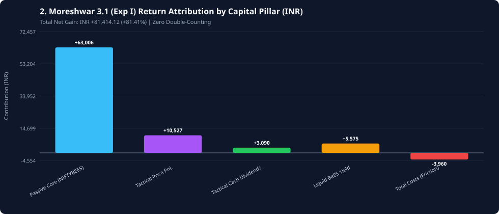
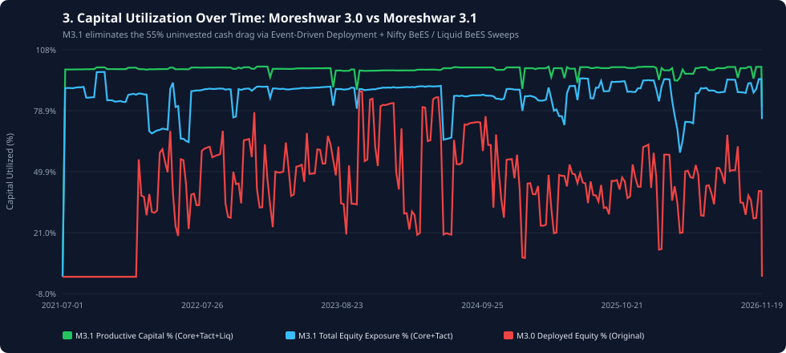

# MORESHWAR 3.1 (PROMPT 2/5) — INTELLIGENT CAPITAL ALLOCATION & PORTFOLIO ENGINE ARCHITECTURE

- **Generated At:** `2026-11-20T03:57:23.495467+00:00` | **Dataset:** `m3_20261119T191710Z` | **Seed:** `20261119` | **Capital:** `INR 100,000`
- **Validation Split:** Train `2021-07-01 -> 2023-12-31` | Validation `2024-01-01 -> 2025-03-31` | Untouched OOS `2025-04-01 -> 2026-11-19`
- **Selected Robust Architecture (Chosen Strictly on Train+Validation):** **`I. Full Intelligent Capital Allocation (RISK_BUDGETED 70/20/10)`**

## 1. Three-Pillar Capital Allocation Blueprint

| Capital Pillar | Instrument / Engine | Role & Rebalancing Discipline | Exp I Average Allocation (`2021-07 -> 2026-11`) |
| :--- | :--- | :--- | :---: |
| **A. Passive Core** | Real NSE `NIFTYBEES` (`INF204KB14I2`, `1,454` actual exchange bars) | Continuous total-return Nifty 50 exposure (dividends auto-reinvested inside ETF NAV -> zero double-counting), `5.5%` threshold rebalance band | **`75.5%`** |
| **B. Tactical Strategy Sleeves** | Validated `Family E` (60% sleeve wt) + `Family A` (40% sleeve wt) on split-adjusted `DIV_YIELD_TTM_PIT` & 4-tier sectors | Event-driven replenishment (`2d` min gap), `INR 6,500` min lot, cost-alpha hurdle (`>= 120 bps`), no tight `+0.65%` BE stop | **`11.2%`** |
| **C. Liquidity & Risk Reserve** | Real NSE `LIQUIDBEES` (`INF732E01037`, `6.35%` net effective yield) | Dry powder for event-driven tactical fills, defensive expansion in `WEAK_BEAR` / `STRESS_BEAR`, automatic sweep of idle cash (`> INR 3,000`) | **`11.7%`** |
| *Settlement / Operational Cash* | NSE T+1 Unsettled + Operational Buffer | Strictly bounded; average uninvested 0% cash cut from `55.0%` (M3.0) to **`1.7%`** | **`1.7%`** |

## 2. Comparative Experiments A through I (`INR 100,000`, Identical Dates)

| Exp | Architecture | Full Return (`2021-07 -> 2026-11`) | Full CAGR | Full Max DD | Full Sharpe | OOS Return (`2025-04 -> 2026-11`) | OOS Max DD | Productive Cap % | Total Cost (`INR`) | Turnover |
| :--- | :--- | :---: | :---: | :---: | :---: | :---: | :---: | :---: | :---: | :---: |
| `EXP_A_ORIGINAL_M3_0` | A. Original Moreshwar 3.0 (Frozen PORT_RISK_BUDGETED) | **`+7.43%`** | `+1.37%` | `16.50%` | `-0.55` | **`+15.70%`** | `7.94%` | `45.0%` | `INR 9,825.77` | `32.4x` |
| `EXP_B_M3_0_WITH_DIVIDENDS` | B. Original Moreshwar 3.0 + Verified Ex-Date Dividends (Uninvested Cash) | **`+13.51%`** | `+2.43%` | `14.94%` | `-0.45` | **`+16.65%`** | `7.89%` | `45.0%` | `INR 9,825.77` | `32.4x` |
| `EXP_C_PASSIVE_NIFTYBEES` | C. Passive Nifty BeES (100% Real NSE Accumulating ETF) | **`+69.73%`** | `+10.53%` | `15.24%` | `+0.35` | **`+11.33%`** | `14.71%` | `98.4%` | `INR 147.95` | `1.5x` |
| `EXP_D_PASSIVE_45_NIFTY_55_LIQUID` | D. Passive 45% Nifty BeES + 55% Liquid BeES (Executable) | **`+52.99%`** | `+8.38%` | `6.18%` | `+0.31` | **`+10.66%`** | `6.24%` | `99.0%` | `INR 89.68` | `1.3x` |
| `EXP_E_CORE_PLUS_FAMILY_E` | E. Passive Core (60%) + Family E Defensive Compounder (30%) + Liquid (10%) | **`+79.23%`** | `+11.68%` | `16.86%` | `+0.47` | **`+23.41%`** | `11.22%` | `98.3%` | `INR 7,241.73` | `31.1x` |
| `EXP_F_CORE_PLUS_FAMILY_A` | F. Passive Core (60%) + Family A Momentum (30%) + Liquid (10%) | **`+66.08%`** | `+10.08%` | `15.38%` | `+0.33` | **`+5.63%`** | `13.46%` | `98.1%` | `INR 6,738.18` | `26.8x` |
| `EXP_G_CORE_PLUS_FAM_E_AND_A` | G. Passive Core (60%) + Family E & A (30%) + Liquid (10%) [Fixed] | **`+56.55%`** | `+8.86%` | `18.86%` | `+0.24` | **`+15.17%`** | `14.74%` | `98.2%` | `INR 7,232.78` | `30.9x` |
| `EXP_H_DYNAMIC_TACTICAL_NO_FORCED_CORE` | H. Dynamic Capital Allocation Across Validated Sleeves (0% Forced Core, 80% Tact / 20% Liquid) | **`+74.76%`** | `+11.15%` | `22.16%` | `+0.41` | **`+0.49%`** | `19.71%` | `97.1%` | `INR 16,463.67` | `75.3x` |
| `EXP_I_FULL_INTELLIGENT_ALLOCATION` | I. Full Intelligent Capital Allocation (RISK_BUDGETED 70/20/10) | **`+81.41%`** | `+11.94%` | `13.37%` | `+0.51` | **`+9.04%`** | `16.62%` | `98.3%` | `INR 3,959.82` | `23.9x` |

## 3. Train / Validation Policy Comparison (No OOS Peeking)

| Allocation Mode | Base Core/Tact/Liq | Train Ret | Train DD | Train Sharpe | Val Ret | Val DD | Val Sharpe | Train+Val Robust Score |
| :--- | :---: | :---: | :---: | :---: | :---: | :---: | :---: | :---: |
| `RISK_BUDGETED` | `70/20/10` | `+52.15%` | `9.91%` | `+1.05` | `+8.30%` | `13.48%` | `+0.06` | **`+1.031`** |
| `RISK_BUDGETED` | `60/30/10` | `+59.33%` | `9.15%` | `+1.22` | `+5.62%` | `14.71%` | `-0.12` | **`+1.012`** |
| `RISK_BUDGETED` | `50/30/20` | `+53.85%` | `8.98%` | `+1.18` | `+3.99%` | `13.65%` | `-0.26` | **`+0.908`** |
| `DRAWDOWN_AWARE` | `70/20/10` | `+51.47%` | `10.65%` | `+1.01` | `+4.21%` | `14.92%` | `-0.22` | **`+0.787`** |
| `FIXED` | `70/20/10` | `+50.88%` | `10.65%` | `+0.99` | `+4.10%` | `16.07%` | `-0.21` | **`+0.753`** |
| `CONFIDENCE_WEIGHTED` | `50/30/20` | `+44.63%` | `10.53%` | `+0.95` | `+4.51%` | `14.94%` | `-0.21` | **`+0.728`** |
| `DRAWDOWN_AWARE` | `50/30/20` | `+41.64%` | `8.83%` | `+0.85` | `+4.59%` | `15.09%` | `-0.21` | **`+0.714`** |
| `FIXED` | `60/30/10` | `+49.78%` | `10.82%` | `+0.99` | `+4.05%` | `17.24%` | `-0.21` | **`+0.713`** |
| `REGIME_AWARE` | `60/30/10` | `+42.59%` | `11.29%` | `+0.82` | `+5.80%` | `14.92%` | `-0.10` | **`+0.700`** |
| `FIXED` | `50/30/20` | `+42.50%` | `8.92%` | `+0.88` | `+3.98%` | `15.73%` | `-0.24` | **`+0.695`** |
| `DRAWDOWN_AWARE` | `60/30/10` | `+44.82%` | `10.75%` | `+0.86` | `+4.98%` | `15.73%` | `-0.16` | **`+0.691`** |
| `CONFIDENCE_WEIGHTED` | `60/30/10` | `+47.95%` | `12.46%` | `+0.95` | `+4.36%` | `16.48%` | `-0.20` | **`+0.667`** |

## 4. Sensitivity Perturbation (±5% Weight Shifts) & 5-Fold Walk-Forward Stability

| Sensitivity Perturbation | Core/Tact/Liq | Full Return | Full CAGR | Full Max DD | Full Sharpe | Untouched OOS Return | OOS Max DD | OOS Sharpe |
| :--- | :---: | :---: | :---: | :---: | :---: | :---: | :---: | :---: |
| `BASE_SELECTED` | `70/20/10` | `+81.41%` | `+11.94%` | `13.37%` | `+0.51` | `+9.04%` | `16.62%` | `-0.05` |
| `CORE_PLUS_5_TACT_MINUS_5` | `75/15/10` | `+78.39%` | `+11.58%` | `14.20%` | `+0.47` | `+6.95%` | `15.63%` | `-0.17` |
| `CORE_MINUS_5_TACT_PLUS_5` | `65/25/10` | `+75.82%` | `+11.28%` | `16.39%` | `+0.45` | `+6.52%` | `16.98%` | `-0.19` |
| `CORE_MINUS_5_LIQ_PLUS_5` | `65/20/15` | `+77.15%` | `+11.43%` | `13.15%` | `+0.48` | `+8.61%` | `15.90%` | `-0.08` |
| `TACT_MINUS_5_LIQ_PLUS_5` | `70/15/15` | `+76.62%` | `+11.37%` | `13.29%` | `+0.47` | `+6.68%` | `15.33%` | `-0.19` |
| `CORE_PLUS_5_LIQ_MINUS_5` | `75/20/5` | `+71.08%` | `+10.70%` | `14.27%` | `+0.39` | `+8.37%` | `17.61%` | `-0.08` |

| Walk-Forward Fold | Window | Exp I Return | Exp I Max DD | Exp I Sharpe | Nifty BeES Return | 45/55 ETF Return | Excess vs Nifty BeES | Excess vs 45/55 |
| :--- | :---: | :---: | :---: | :---: | :---: | :---: | :---: | :---: |
| `WF1_2021H2_2022H1` | `2021-07-01 -> 2022-06-30` | **`+9.13%`** | `9.91%` | `+0.25` | `+1.19%` | `+4.17%` | `+7.94 pp` | `+4.96 pp` |
| `WF2_2022H2_2023H1` | `2022-07-01 -> 2023-06-30` | **`+20.25%`** | `8.00%` | `+1.34` | `+21.57%` | `+12.93%` | `-1.32 pp` | `+7.32 pp` |
| `WF3_2023H2_2024H1` | `2023-07-01 -> 2024-06-30` | **`+22.71%`** | `5.17%` | `+1.50` | `+22.08%` | `+13.23%` | `+0.63 pp` | `+9.48 pp` |
| `WF4_2024H2_2025Q1` | `2024-07-01 -> 2025-03-31` | **`-2.96%`** | `13.45%` | `-0.96` | `-3.23%` | `+1.06%` | `+0.27 pp` | `-4.02 pp` |
| `WF5_2025Q2_2026M11_OOS` | `2025-04-01 -> 2026-11-19` | **`+9.04%`** | `16.62%` | `-0.05` | `+11.33%` | `+10.66%` | `-2.29 pp` | `-1.62 pp` |

## 5. Visual Diagnostics (Embedded Charts)

