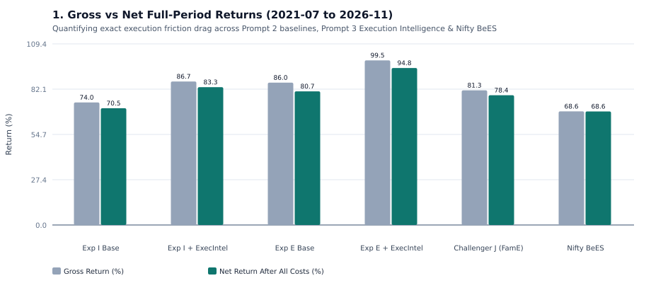
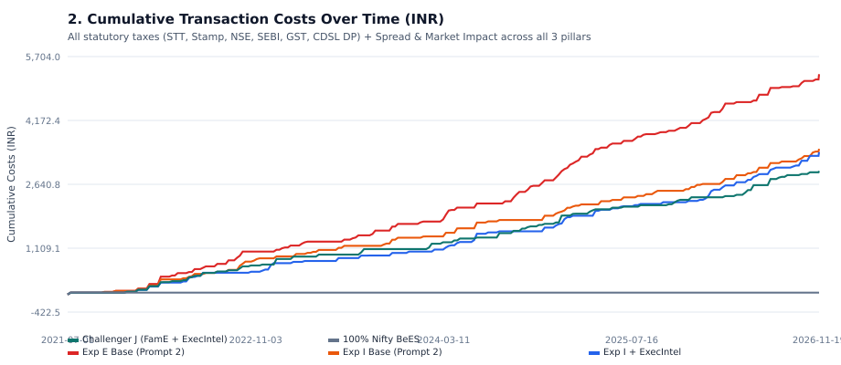
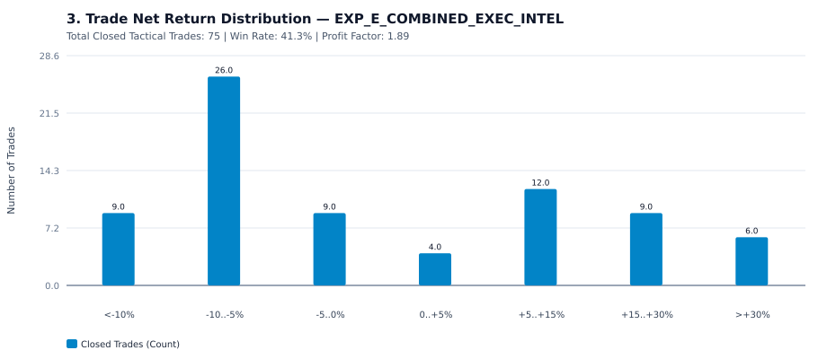
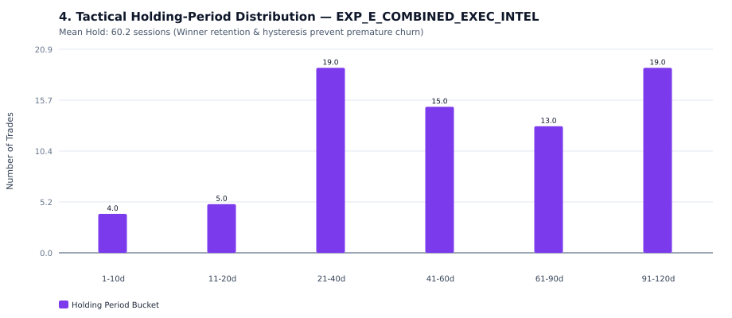
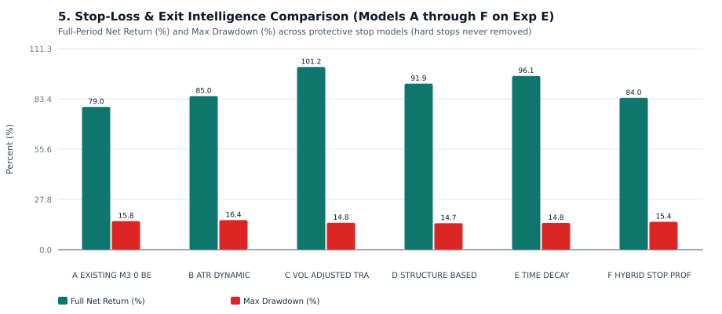
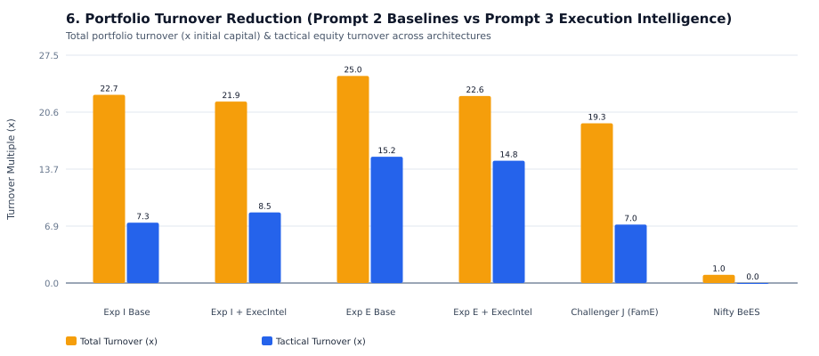
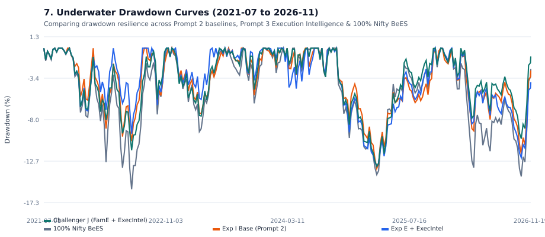
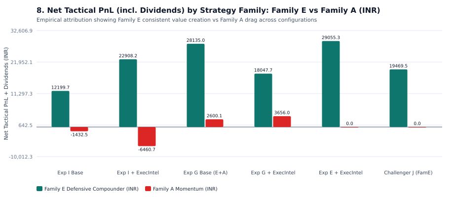

# MORESHWAR 3.1 (PROMPT 3/5) — INTELLIGENT EXECUTION, TRANSACTION COST & TRADE QUALITY ARCHITECTURE

- **Generated At:** `2026-11-20T04:42:35.380646+00:00` | **Capital:** `INR 100,000` | **Full Window:** `2021-07-01 -> 2026-11-19`
- **Total Experiments Executed & Logged:** `204` (all recorded; multiple-testing Deflated Sharpe Prob = `0.603`)
- **Inner-Selected Best Portfolio + Execution Architecture (Zero OOS Peeking):** **`Exp E (FIXED 60/30/10, Core + Fam E) + Combined Execution Intelligence`**
- **Prompt 2 Baselines Preserved:** `Exp I (RISK_BUDGETED 70/20/10)` & `Exp E (FIXED 60/30/10 Core + Family E)` maintained side-by-side.

> [!WARNING]
> **Strict Anti-Overfitting Disclosure (Section 9):** The `2025-04-01 -> 2026-11-19` window was previously inspected during Prompts 1 & 2 and is **NOT presented as an untouched holdout** here. All architecture and component selections were performed strictly on chronological inner windows (`2021-07 -> 2024-06` and expanding nested walk-forward inner folds), with blind outer-fold evaluation across 3 nested walk-forward periods.

## 1. Five Modular Execution Intelligence Layers

| Layer | Module | Responsibility & Anti-Duplication Guarantee |
| :--- | :--- | :--- |
| **1. Cost Intelligence** | `transaction_cost_intelligence.py` | Single authoritative Indian tariff calculator (`PRE_OCT_2024`: NSE `0.00325%`, CDSL DP `INR 15.93`; `POST_OCT_2024`: NSE `0.00297%`, CDSL DP `INR 15.34`; Equity ETF `0.001%` sell STT; Liquid ETF `0%` STT + `0.005%` stamp; square-root market impact + HL spread). Zero double-counting. |
| **2. Trade Economic Value** | `trade_quality_models.py` (`estimate_trade_economic_value`) | Estimates causal expected gross return, holding horizon, volatility, downside, exact entry+exit costs, expected net alpha (bps), risk-adjusted return, and `P(outperform)`. Rejects sub-hurdle trades (`FIXED_60..200` & `DYNAMIC_VOL`). |
| **3. Position Replacement** | `trade_quality_models.py` (`evaluate_position_replacement`) | Evaluates 10 dimensions (incumbent quality, candidate quality, net edge delta, remaining hold, unrealized PnL winner shield, close+open switch cost, sector, concentration, regime) to eliminate low-value churn. |
| **4. Stop-Loss & Exit** | `trade_quality_models.py` (`evaluate_position_exit`) | Compares 6 protective exit models (`A..F`), preserving catastrophe stops and ex-dividend downward stop adjustments on all models while eliminating premature `STOP_LOSS_BE` winner termination. |
| **5. Timing & Sizing** | `trade_quality_models.py` (`simulate_execution_fill`, `compute_intelligent_position_size`) | Models circuit locks, 1% bar-volume & ADV caps, gap guards, limit fills (`VWAP` explicitly flagged `APPROXIMATION_NO_INTRADAY_DATA`), and 6 position-sizing engines (`A..F`). |

## 2. Controlled Architecture & Combined Execution Intelligence Comparison (`2021-07 -> 2026-11`)

| Architecture | Gross Ret | Net Ret | CAGR | Max DD | Sharpe | PF | Win % | Trades | Avg Hold | Turnover | Total Cost (`INR`) | Cost % Gross | Fam E PnL | Fam A PnL |
| :--- | :---: | :---: | :---: | :---: | :---: | :---: | :---: | :---: | :---: | :---: | :---: | :---: | :---: | :---: |
| `PASSIVE_NIFTYBEES` | `+68.64%` | **`+68.60%`** | `+10.40%` | `16.02%` | `+0.33` | `0.00` | `0.0%` | `0` | `0.0d` | `1.0x` | `INR 44.31` | `0.1%` | `INR +0` | `INR +0` |
| `PASSIVE_45_55_ETF` | `+53.16%` | **`+53.08%`** | `+8.39%` | `6.09%` | `+0.31` | `0.00` | `0.0%` | `0` | `0.0d` | `1.3x` | `INR 88.59` | `0.2%` | `INR +0` | `INR +0` |
| `EXP_I_BASE_PROMPT2` | `+74.01%` | **`+70.52%`** | `+10.63%` | `14.25%` | `+0.40` | `1.58` | `41.9%` | `43` | `61.8d` | `22.7x` | `INR 3,492.11` | `4.7%` | `INR +12,200` | `INR -1,433` |
| `EXP_E_BASE_PROMPT2` | `+86.00%` | **`+80.72%`** | `+11.86%` | `17.01%` | `+0.50` | `1.81` | `47.7%` | `88` | `63.3d` | `25.0x` | `INR 5,281.52` | `6.1%` | `INR +25,540` | `INR +0` |
| `EXP_G_BASE_PROMPT2` | `+90.69%` | **`+85.55%`** | `+12.42%` | `16.10%` | `+0.54` | `1.91` | `48.3%` | `87` | `63.5d` | `24.1x` | `INR 5,141.17` | `5.7%` | `INR +28,135` | `INR +2,600` |
| `STEP2_EXP_E_REDUCED_TURNOVER` | `+86.78%` | **`+81.88%`** | `+11.99%` | `15.84%` | `+0.50` | `1.69` | `46.7%` | `90` | `61.1d` | `22.0x` | `INR 4,904.80` | `5.7%` | `INR +25,316` | `INR +0` |
| `STEP3_EXP_E_ALPHA_HURDLE` | `+80.39%` | **`+75.96%`** | `+11.29%` | `15.98%` | `+0.45` | `1.60` | `41.3%` | `75` | `60.2d` | `22.1x` | `INR 4,434.10` | `5.5%` | `INR +19,822` | `INR +0` |
| `STEP4_EXP_E_INTEL_REPLACE` | `+94.80%` | **`+90.46%`** | `+12.97%` | `16.06%` | `+0.60` | `1.88` | `48.7%` | `78` | `68.9d` | `19.3x` | `INR 4,339.82` | `4.6%` | `INR +30,286` | `INR +0` |
| `STEP5_EXP_E_STOP_INTEL` | `+106.52%` | **`+101.15%`** | `+14.15%` | `14.85%` | `+0.67` | `2.26` | `43.5%` | `92` | `58.7d` | `24.2x` | `INR 5,365.07` | `5.0%` | `INR +44,566` | `INR +0` |
| `STEP6_EXP_E_EXEC_TIMING` | `+90.14%` | **`+85.03%`** | `+12.36%` | `16.35%` | `+0.54` | `1.93` | `48.3%` | `89` | `60.2d` | `23.8x` | `INR 5,115.38` | `5.7%` | `INR +29,248` | `INR +0` |
| `STEP7_EXP_E_POS_SIZING` | `+93.42%` | **`+88.21%`** | `+12.72%` | `15.84%` | `+0.57` | `2.02` | `49.4%` | `83` | `61.6d` | `25.0x` | `INR 5,205.73` | `5.6%` | `INR +34,338` | `INR +0` |
| `EXP_I_COMBINED_EXEC_INTEL` | `+86.68%` | **`+83.27%`** | `+12.15%` | `13.96%` | `+0.52` | `1.77` | `47.7%` | `44` | `53.3d` | `21.9x` | `INR 3,412.17` | `3.9%` | `INR +22,908` | `INR -6,461` |
| `EXP_E_COMBINED_EXEC_INTEL` | `+99.46%` | **`+94.84%`** | `+13.46%` | `13.82%` | `+0.62` | `1.89` | `41.3%` | `75` | `60.2d` | `22.6x` | `INR 4,618.74` | `4.6%` | `INR +29,055` | `INR +0` |
| `EXP_G_COMBINED_EXEC_INTEL` | `+83.77%` | **`+79.24%`** | `+11.68%` | `14.06%` | `+0.47` | `1.62` | `50.0%` | `86` | `59.2d` | `19.9x` | `INR 4,521.22` | `5.4%` | `INR +18,048` | `INR +3,656` |
| `EXP_J_CHALLENGER_RB_65_25_10_FAME` | `+81.33%` | **`+78.37%`** | `+11.58%` | `14.02%` | `+0.48` | `2.26` | `51.4%` | `35` | `63.5d` | `19.3x` | `INR 2,959.71` | `3.6%` | `INR +19,469` | `INR +0` |

## 3. Nested Walk-Forward Validation (3 Expanding Outer Folds — Zero Selection Leakage)

| Outer Fold | Inner Selection Window | Blind Outer Test Window | Inner-Selected Preset | Outer Net Return | Outer Max DD | Outer Sharpe | Exp I Base | Exp E Base | Nifty BeES | 45/55 ETF | Excess vs Nifty |
| :--- | :---: | :---: | :--- | :---: | :---: | :---: | :---: | :---: | :---: | :---: | :---: |
| `NWF_FOLD1` | `2021-07-01 -> 2023-06-30` | `2023-07-01 -> 2024-06-30` | `PRESET_EXP_I_EXEC` | **`+20.35%`** | `5.29%` | `+1.29` | `+17.71%` | `+22.48%` | `+22.17%` | `+13.13%` | **`-1.82 pp`** |
| `NWF_FOLD2` | `2021-07-01 -> 2024-06-30` | `2024-07-01 -> 2025-06-30` | `PRESET_EXP_E_EXEC` | **`+4.19%`** | `13.46%` | `-0.17` | `+5.04%` | `+1.17%` | `+5.26%` | `+5.62%` | **`-1.07 pp`** |
| `NWF_FOLD3` | `2021-07-01 -> 2025-06-30` | `2025-07-01 -> 2026-11-19` | `PRESET_EXP_E_EXEC` | **`+3.09%`** | `11.71%` | `-0.37` | `+0.37%` | `-1.32%` | `+0.89%` | `+4.89%` | **`+2.20 pp`** |

- **Stitched 3-Fold Nested Walk-Forward Compounded Return (`2023-07-01 -> 2026-11-19`):** **`+29.27%`** vs Executable `NIFTYBEES` **`+29.74%`** (`-0.47 pp`) and `45/55 ETF` **`+25.33%`** (`+3.94 pp`).
- **Recent Uninspected Sub-Tail (`2026-04-01 -> 2026-11-19`):** Selected `EXP_E_COMBINED_EXEC_INTEL` = **`+3.24%`** (DD `9.11%`) vs `Exp I Base` `+10.20%`, `Exp E Base` `+4.81%`, and `NIFTYBEES` `+12.97%`.

## 4. Parameter Perturbation & Regime Stability

| Perturbation Around Selected Config | Full Return | Full CAGR | Full Max DD | Full Sharpe | Total Cost (`INR`) | Turnover | 2025-04->2026-11 Ret | 2025-04->2026-11 Sharpe |
| :--- | :---: | :---: | :---: | :---: | :---: | :---: | :---: | :---: |
| `BASE_SELECTED` | `+94.84%` | `+13.46%` | `13.82%` | `+0.62` | `INR 4,618.74` | `22.6x` | `+13.12%` | `+0.17` |
| `BAND_MINUS_2PP` | `+80.41%` | `+11.82%` | `13.63%` | `+0.49` | `INR 4,483.78` | `22.2x` | `+13.12%` | `+0.17` |
| `BAND_PLUS_2PP` | `+81.70%` | `+11.97%` | `13.47%` | `+0.50` | `INR 4,123.81` | `19.8x` | `+13.12%` | `+0.17` |
| `HURDLE_150_FIXED` | `+94.35%` | `+13.41%` | `12.56%` | `+0.61` | `INR 4,492.74` | `20.4x` | `+11.49%` | `+0.08` |
| `HURDLE_DYNAMIC_VOL` | `+91.26%` | `+13.06%` | `15.99%` | `+0.61` | `INR 4,344.85` | `19.3x` | `+10.56%` | `+0.03` |
| `MIN_LOT_8000` | `+99.72%` | `+13.99%` | `12.20%` | `+0.66` | `INR 4,180.13` | `21.1x` | `+11.71%` | `+0.09` |
| `HOLD_ROTATE_PLUS_10D` | `+94.84%` | `+13.46%` | `13.82%` | `+0.62` | `INR 4,618.74` | `22.6x` | `+13.12%` | `+0.17` |

| Market Regime | Sessions | Selected Cum Return | Selected Ann Vol | Nifty BeES Cum Return | Nifty BeES Ann Vol |
| :--- | :---: | :---: | :---: | :---: | :---: |
| `STRONG_BULL` | `285` | `+16.17%` | `10.03%` | `-0.53%` | `11.01%` |
| `WEAK_BULL` | `427` | `+22.93%` | `11.05%` | `+18.81%` | `10.71%` |
| `SIDEWAYS_CHOP` | `317` | `+7.09%` | `9.99%` | `+6.00%` | `11.55%` |
| `BEAR (WEAK+STRESS)` | `302` | `+27.41%` | `11.97%` | `+34.58%` | `16.60%` |

## 5. Visual Diagnostics (All 8 Required Charts)

