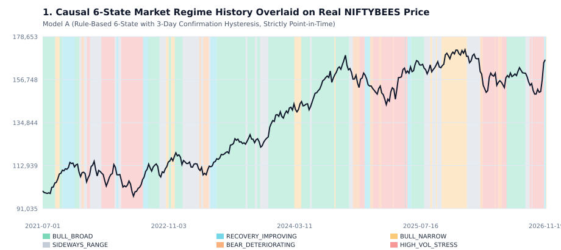
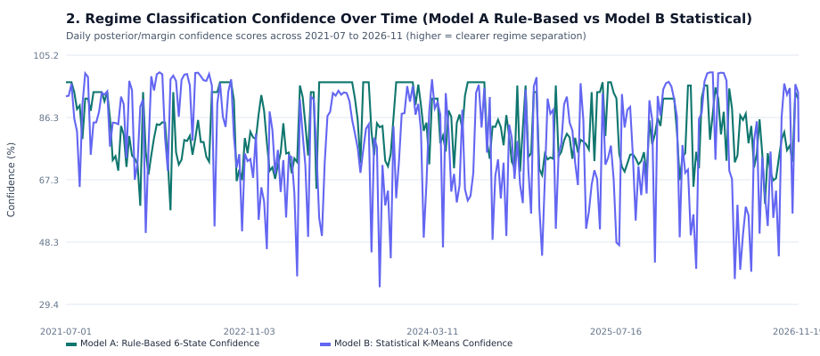
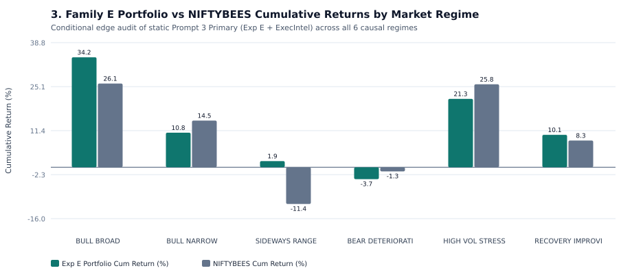
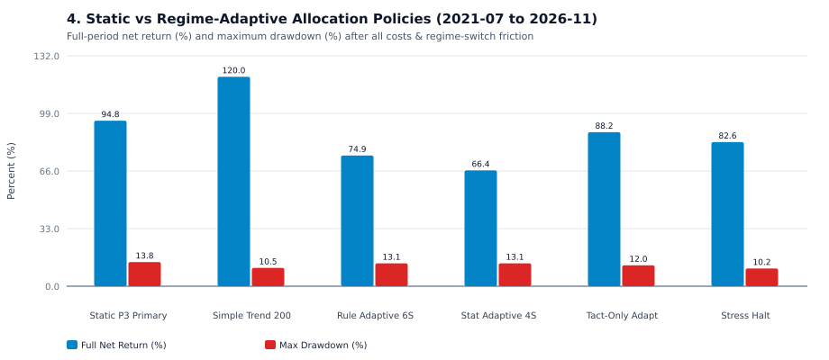
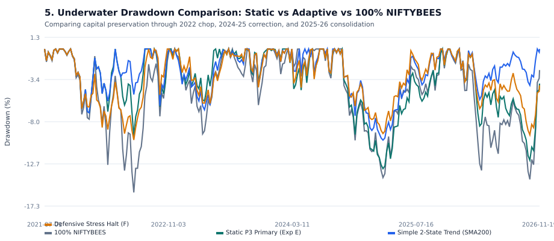
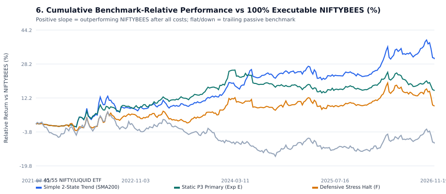
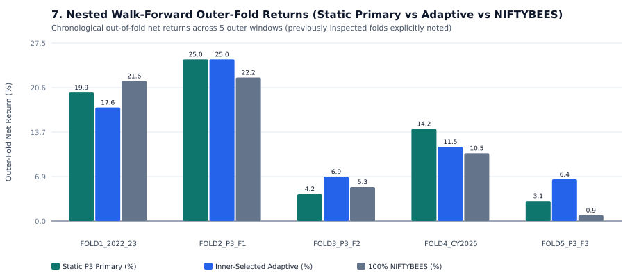
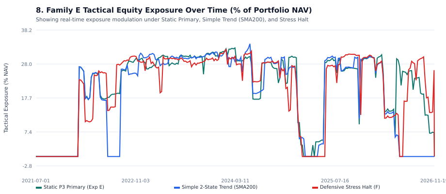

# MORESHWAR 3.1 (PROMPT 4/5) — STRATEGY INTELLIGENCE, REGIME & ADAPTIVE ALPHA ARCHITECTURE

- **Generated At:** `2026-11-20T05:03:18.570295+00:00` | **Git SHA:** `e6af98fa70a8` | **Frozen Config Hash:** `47a30f4bbd004c5f`
- **Prompt 3 Reproduction Verification:** Primary `EXP_E_COMBINED_EXEC_INTEL` = **`+94.84%`** (Stored: `+94.84%`, Diff = **`+0.0000 pp`**); Challenger `EXP_J` = **`+78.37%`** (Diff = **`+0.0000 pp`**).
- **Cumulative Research History:** `204` Prompt 3 experiments + `161` Prompt 4 experiments = **`365` total logged runs**.

## 1. Adaptive Allocation Policy Comparison (`2021-07-01 -> 2026-11-19` & Outer `2024-07 -> 2026-11`)

| Policy | Regime Source | Full Net Ret | Full CAGR | Full Max DD | Full Sharpe | Full Calmar | Outer (`2024-07->2026-11`) Ret | Outer DD | Outer Sharpe | Turnover | Cost (`INR`) | Avg Tact % |
| :--- | :--- | :---: | :---: | :---: | :---: | :---: | :---: | :---: | :---: | :---: | :---: | :---: |
| `A_STATIC_PROMPT3_PRIMARY` | `NONE` | **`+94.84%`** | `+13.46%` | `13.82%` | `+0.62` | `0.97` | `+9.76%` | `13.46%` | `-0.19` | `22.6x` | `INR 4,619` | `21.6%` |
| `B_STATIC_PROMPT3_CHALLENGER` | `NONE` | **`+78.37%`** | `+11.58%` | `14.02%` | `+0.48` | `0.83` | `+4.84%` | `14.90%` | `-0.37` | `19.3x` | `INR 2,960` | `12.4%` |
| `C_RULE_ADAPTIVE_FULL` | `RULE_6STATE` | **`+74.90%`** | `+11.17%` | `13.12%` | `+0.47` | `0.85` | `+3.73%` | `11.68%` | `-0.52` | `40.5x` | `INR 5,125` | `19.1%` |
| `D_STAT_REGIME_ADAPTIVE` | `STAT_4STATE` | **`+66.36%`** | `+10.12%` | `13.09%` | `+0.37` | `0.77` | `+6.80%` | `10.99%` | `-0.37` | `48.1x` | `INR 5,148` | `19.0%` |
| `E_ADAPTIVE_TACTICAL_STATIC_CORE` | `RULE_6STATE` | **`+88.22%`** | `+12.72%` | `11.99%` | `+0.60` | `1.06` | `+5.30%` | `11.59%` | `-0.42` | `34.4x` | `INR 4,922` | `18.7%` |
| `F_DEFENSIVE_STRESS_HALT` | `RULE_6STATE` | **`+82.58%`** | `+12.07%` | `10.15%` | `+0.54` | `1.19` | `+5.12%` | `11.29%` | `-0.44` | `37.6x` | `INR 4,660` | `21.0%` |
| `G_SIMPLE_TREND_BASELINE` | `SIMPLE_TREND` | **`+120.03%`** | `+16.10%` | `10.46%` | `+0.87` | `1.54` | `+15.74%` | `9.73%` | `+0.01` | `26.1x` | `INR 3,962` | `19.0%` |
| `PASSIVE_NIFTYBEES` | `BENCHMARK` | **`+68.60%`** | `+10.40%` | `16.02%` | `+0.33` | `0.65` | `+6.75%` | `15.14%` | `-0.24` | `1.0x` | `INR 44` | `0.0%` |
| `PASSIVE_45_55_ETF` | `BENCHMARK` | **`+53.08%`** | `+8.39%` | `6.09%` | `+0.31` | `1.38` | `+11.14%` | `5.92%` | `-0.35` | `1.3x` | `INR 89` | `0.0%` |

## 2. Family E Conditional Edge Across All 6 Regimes

| Regime | Days | Trades | Win % | PF | Net Profit (`INR`) | Avg Hold | Avg MAE | Avg MFE | Port Cum Ret | NiftyBeES Ret | Rel vs Nifty |
| :--- | :---: | :---: | :---: | :---: | :---: | :---: | :---: | :---: | :---: | :---: | :---: |
| `BULL_BROAD` | `484` | `31` | `45.2%` | `2.74` | `INR +20,539` | `59.1d` | `-5.7%` | `+17.1%` | `+34.22%` | `+26.05%` | **`+8.17 pp`** |
| `BULL_NARROW` | `127` | `6` | `50.0%` | `2.50` | `INR +3,432` | `76.3d` | `-6.1%` | `+17.4%` | `+10.76%` | `+14.53%` | **`-3.78 pp`** |
| `SIDEWAYS_RANGE` | `258` | `16` | `37.5%` | `1.26` | `INR +2,135` | `53.4d` | `-7.8%` | `+14.1%` | `+1.93%` | `-11.42%` | **`+13.35 pp`** |
| `BEAR_DETERIORATING` | `78` | `1` | `0.0%` | `0.00` | `INR -1,007` | `54.0d` | `-9.0%` | `+3.0%` | `-3.70%` | `-1.28%` | **`-2.42 pp`** |
| `HIGH_VOL_STRESS` | `285` | `20` | `35.0%` | `1.22` | `INR +2,003` | `59.8d` | `-7.6%` | `+13.9%` | `+21.29%` | `+25.81%` | **`-4.52 pp`** |
| `RECOVERY_IMPROVING` | `99` | `1` | `100.0%` | `99.00` | `INR +1,953` | `117.0d` | `-0.5%` | `+38.3%` | `+10.09%` | `+8.32%` | **`+1.77 pp`** |

## 3. Visual Diagnostics (All 8 Real-Data Charts)

